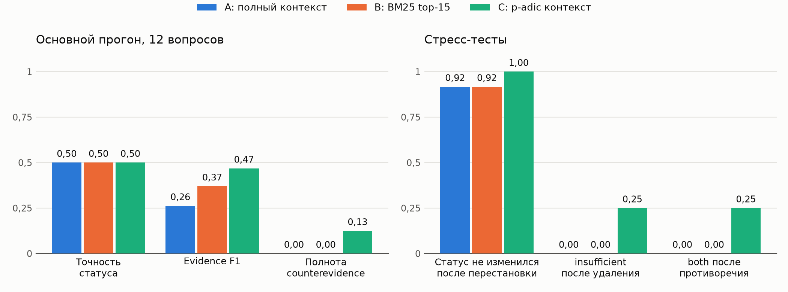

# Лабораторная работа №6. AI-детектив

Курс: Автоматическая обработка текстов
Группа К3440: Мещеряков Даниил Павлович (409130), Соболь Владимир Вячеславович (409594)
Репозиторий: github.com/Toneryy/aot-2026, папка labs/lab6

## 1. Досье и эталоны

Сюжет вымышленный: закрытая сборка игры «Северный Прилив» студии «Тихий Бор» утекла на форум «Бухта Бит». Сначала в `data/truth.md` зафиксирована истинная последовательность событий, затем написаны 10 документов на 5641 слово, каждый раскрывает только часть событий:
- описание инцидента с временной шкалой;
- три сообщения участников;
- фрагмент чата;
- выгрузка журналов (хранилище, реестр водяных знаков, проходная, телефония);
- регламент;
- распоряжение-исключение;
- два нерелевантных отчета на близкие темы.

Шкала вложена в описание инцидента, иначе обязательный состав не помещается в 10 документов.

Выделено 40 утверждений: 31 direct, 4 disputed, 3 reported и 2 inferred. Evidence каждого утверждения дословно и ровно один раз входит в свой документ, это проверяет `make_data.py`. Вопросов 12, по два каждого типа. Эталонные статусы: 5 entailed, 4 contradicted, 1 both, 2 insufficient.

В досье заложены ловушки:
- форум показывает время в UTC, а журналы студии ведутся по Москве;
- ключ технически открывал полный архив, хотя распоряжение разрешало только файлы локализации;
- свидетель противоречит журналу проходной;
- о содержании звонка есть две версии, а записи нет.

До запуска модели эталоны вслепую проверил второй экземпляр ассистента: 12 статусов совпали, пять найденных несостыковок исправлены. После прогона эталоны проверили оба участника, правок не потребовалось.

## 2. Стенд и режимы

Код, данные и все ответы модели лежат в репозитории github.com/Toneryy/aot-2026, папка labs/lab6. Модель: qwen2.5:7b через Ollama, temperature 0, seed 42, окно 20480 токенов, ответ по JSON-схеме Pydantic. Промпт и параметры одинаковы во всех режимах.

Ответ модели проверяется:
- ответ соответствует схеме;
- все идентификаторы существуют в claims.jsonl;
- при both заполнены counterevidence;
- при insufficient answer равен null и в ответе нет времени или кодов, которых нет в контексте.

При ошибке разрешен один повторный запрос. В основном прогоне он не понадобился ни разу.

- **A:** все документы в фиксированном порядке. После каждого evidence стоит метка [Cxx], чтобы модель могла ссылаться на утверждения. Контекст занимает 15,9 тыс. токенов.
- **B:** BM25 (псевдооснова 5 символов) по текстам утверждений, top-15 плоским списком.
- **C:** те же 15 утверждений, сгруппированные по p-adic ветвям, внутри ветви по времени факта.

p-adic путь [a0, a1, a2]:
- a0, тип источника: журнал или документ, свидетельство, правило или интерпретация;
- a1, статус: установленный факт, сообщение, спорное или исключение;
- a2, время: до, во время, после события или неизвестно.

Код x = a0 + 3a1 + 9a2. Расстояние равно 3^(-k), где k число совпадающих начальных уровней. Тесты сверяют его с 3-адическим нормированием разности кодов и проверяют ультраметрическое неравенство на всех тройках путей.

Стресс-тесты:
- перестановка документов с random_state=42 (в режиме B переставляется и список утверждений);
- удаление необходимой посылки для multi-hop и временных вопросов, ожидается insufficient;
- несовместимое утверждение от другого источника для всех 12 вопросов, ожидается both.

Каждый вариант меняет один фактор. Всего 120 запросов.

## 3. Результаты

| Метрика | A | B | C |
|---|---|---|---|
| Точность статуса | 0,50 | 0,50 | 0,50 |
| Evidence P / R / F1 | 0,27 / 0,29 / 0,26 | 0,37 / 0,44 / 0,37 | 0,46 / 0,53 / 0,47 |
| Полнота counterevidence | 0 | 0 | 0,13 |
| both: верно / предсказано / ожидалось (все 40 запусков) | 0 / 0 / 14 | 0 / 0 / 14 | 5 / 7 / 14 |
| insufficient: верно / предсказано / ожидалось | 3 / 5 / 8 | 3 / 4 / 8 | 1 / 1 / 8 |
| Уверенный ответ (0,7 и выше) при нехватке данных | 5 из 8 | 5 из 8 | 5 из 8 |
| Средняя уверенность / ECE | 0,92 / 0,61 | 0,95 / 0,64 | 0,95 / 0,56 |
| Токены промпта | 15 865 | 1 311 | 1 500 |
| Время, медиана (холодный запрос) | 8,4 с (85 с) | 8,1 с | 8,6 с |

Медиана времени в режиме A низкая из-за кэша префикса в Ollama: документы одинаковы, поэтому заново считается только вопрос. Холодный запрос полного контекста идет 85 секунд.

| Стресс-тест | A | B | C |
|---|---|---|---|
| Статус изменился после перестановки | 1 из 12 | 1 из 12 | 0 из 12 |
| Совпадение evidence с исходным (Жаккар) | 0,47 | 0,63 | 1,00 |
| insufficient после удаления посылки | 0 из 4 | 0 из 4 | 1 из 4 |
| both после противоречия, попавшего в контекст | 0 из 12 | 0 из 10 | 3 из 10 |

Все 18 ошибок основного прогона разобраны вручную (`results/error_analysis.csv`):

| Причина | A | B | C |
|---|---|---|---|
| Время не переведено из UTC | Q06 | Q06 | Q06 |
| Свидетель принят вместо журнала | Q09 | Q09 | Q09 |
| Правило применено без исключения | Q08 | Q08 | Q08 |
| Догадка или выдуманный факт | Q04 | Q04, Q11 | Q04 |
| Статус не согласован с объяснением, конфликт не замечен | Q10 | Q10 | Q11 |
| Норма вместо факта или both вместо insufficient | Q12 | нет | Q12 |
| Среди них нужного утверждения нет в top-15 | не применимо | 3 | 4 |

## 4. Ответы на вопросы отчета

1. **Улучшает ли retrieval результат по сравнению с полным текстом?** По статусу нет: 6 из 12 во всех режимах. По доказательствам да: evidence F1 растет с 0,26 до 0,37 при контексте в 12 раз короче, а в режиме A модель часто перечисляет подряд соседние строки журнала. Слабое место в поиске: полнота эталонных утверждений в top-15 равна 0,79. BM25 не находит строку реестра водяных знаков и пункт о тихом периоде, потому что в них нет слов из вопроса. На Q04 и Q08 ошибка B и C начинается именно с поиска.
2. **Улучшает ли p-adic группировка распознавание противоречий?** Да, но частично. both распознает только режим C: Q10 в основном прогоне и 3 из 10 добавленных противоречий (камера против проходной, новый свидетель звонка, коллега против Марка). Режимы A и B не распознали ни одного. Помогает то, что спорные утверждения собраны в отдельные ветви с подписью «спорное». Расхождения в технических данных (два журнала загрузки, две экспертизы водяного знака, два времени регистрации аккаунта) модель не заметила ни в одном режиме.
3. **Отличает ли модель insufficient от правдоподобной догадки?** Плохо. В 5 из 8 случаев с нехваткой данных она дала уверенный entailed или contradicted. Примеры: в режиме B владельцем аккаунта назван Тимур с уверенностью 0,95; в режиме A ответ звучит «не мог скачать намеренно, потому что регламент это запрещает». Режим C почти не отвечает insufficient (1 из 8) и подменяет нехватку данных на both.
4. **Меняется ли ответ после перестановки документов?** В режимах A и B статус изменился по одному разу, оба раза с неверного на верный. Это неустойчивость, а не улучшение. Evidence совпадает с исходным только на 47% и 63%. Режим C от порядка не зависит по построению: контекст после перестановки тот же, и ответы совпали полностью.
5. **Как модель реагирует на удаление необходимой посылки?** Почти не замечает. В режимах A и B все 8 ответов остались entailed с прежней уверенностью, в C insufficient появился один раз из четырех (Q06). Модель достраивает посылку: без водяного знака связывает утечку с ключом RK-02 по совпадению времени, а без строки об отказе в 19:26 подставляет успешное скачивание в 18:31.
6. **Соответствует ли confidence фактической точности?** Нет. От 32 до 36 ответов из 40 в каждом режиме имеют уверенность 0,95 и выше, а их точность 0,28-0,31; ECE от 0,56 до 0,64. Сигнал есть только у редких ответов с уверенностью ниже 0,8: в режиме C оба такие ответа верные.
7. **В каких случаях p-adic структура помогает, а в каких мешает?** Помогает, когда нужно увидеть спор источников разных типов и сохранить ответ при перестановке. У режима C лучшая привязка доказательств (F1 0,47) и единственные распознанные both. Мешает там, где правило, исключение и вывод попадают в разные ветви. В Q08 тихий период лежит в ветви выводов [2,0,1], окно ключа в ветви исключений [2,2,0], и модель ответила по ключу. Подпись «спорное» провоцирует both: 2 из 7 предсказаний both ошибочны.

## 5. Порядок уровней p-adic пути

Первый уровень задает самое крупное деление: утверждения с разным типом источника всегда находятся на расстоянии 1. Тип источника поставлен выше времени, потому что для расследования главное различие в надежности: журнал, свидетель или норма. Время важно, но относится к конкретному утверждению, а надежность определяет, можно ли ему верить.

Если поставить время первым, журнал проходной и показания Ольги окажутся в одной ветви «во время события». Спор источников будет выглядеть как соседние факты. Зато ветви станут хронологией, и это могло бы помочь временным вопросам, на которых ошиблись все режимы. Если поставить первым статус, все спорное соберется вместе независимо от источника. Это удобно для both, но смешает журнал и свидетеля с одинаковым статусом. Другой порядок мы не проверяли, это гипотеза.

## 6. Дополнительная проверка: порядок полей ответа

Схема Ollama заставляет модель назвать статус раньше доказательств. Чтобы проверить, не отсюда ли уклон в «да», мы повторили основной прогон на тех же 36 запросах, поставив в схеме доказательства и объяснение перед статусом. Точность упала до 0,42, 0,33 и 0,33. Уклон сменил форму: в B и C модель стала отвечать both в 12 случаях из 24. Evidence F1 немного вырос (B 0,44, C 0,51). Значит, дело не в порядке полей: модель плохо выбирает логический статус как таковой.

## 7. Выводы и ограничения

- Главные ошибки модели лежат не в поиске, а в логическом статусе. В основном прогоне 31 ответ из 36 это entailed: модель соглашается с вопросом, не переводит время и доверяет свидетелю больше, чем журналу.
- Retrieval сокращает контекст в 10-12 раз при той же точности и лучших доказательствах. p-adic упаковка дает лучшую привязку доказательств и распознавание споров, но не исправляет ошибки со временем и исключениями.
- Ограничения: 12 вопросов и одна модель на 7 млрд параметров. Разница в один вопрос дает 8 процентных пунктов, поэтому различия в точности статуса статистически ненадежны. Выводы относятся только к этой модели и этому досье.

## 8. Вклад участников

- **Соболь:** досье, утверждения, вопросы и эталоны, варианты стресс-тестов, промпт, вызов модели и проверка ответа, разбор ошибок.
- **Мещеряков:** BM25, p-adic модуль, сборка контекста, стресс-тесты, метрики, Streamlit-стенд, тесты.
- **Вместе:** проверка эталонов, выводы и отчет.

Подробности в `CONTRIBUTIONS.md`, эпизоды работы с ИИ в `AI_LOG.md`.
